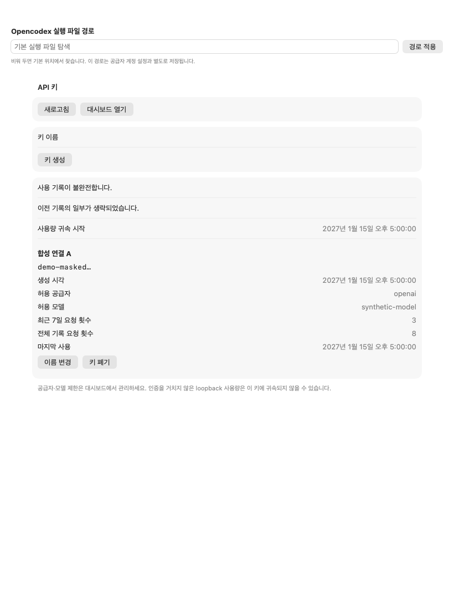
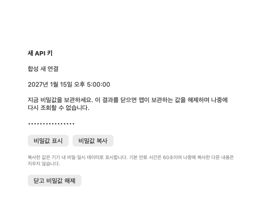
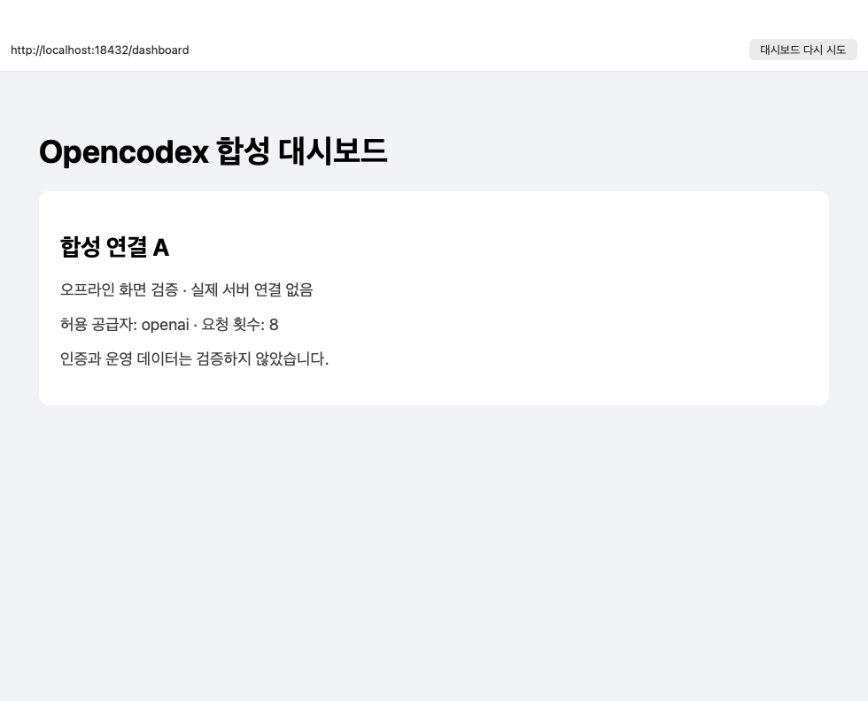

# Opencodex 키 관리와 내장 대시보드

**설정 → Opencodex**에서 로컬 API 키를 관리하거나 **대시보드 열기**를 누릅니다.
이 항목은 Claude·Codex·Grok 공급자 계정 설정과 별개입니다. 공급자 계정의 로그인·전환과 새 데이터 API 키는 서로 다른 기능입니다.
전용 화면은 목록·생성·이름 변경·폐기를 제공하고, 공급자·모델 제한 등 고급 관리는 기존 웹 대시보드에서 수행합니다.

## 로컬 관리 권한과 경로

역할은 Opencodex 상태 응답의 `runtimeRole`로 판정합니다. 기기 이름은 권한 조건이 아닙니다.

| 역할 | 동작 |
| --- | --- |
| `hub` | 이 기기 로컬 허브의 키 관리와 내장 대시보드를 허용합니다. |
| `standalone` | 이 독립 설치의 로컬 키만 관리합니다. 다른 허브의 원격 관리 경로가 아닙니다. |
| `client` | 허브에서 관리하라는 안내를 표시합니다. 키 목록·변경과 내장 대시보드를 시작하지 않습니다. |
| `unknown`·누락·잘못된 응답 | 관리를 허용하지 않습니다. |

현재 배치의 로컬 관리 기기는 m5m1입니다. 연결된 다른 Mac으로 관리 자격을 배포하거나 원격 관리 연결을 추가하지 않습니다.
변경 직전에도 역할과 서버 실행 상태를 다시 확인합니다.
상태에서 사용하는 필드는 `schemaVersion`, `runtimeRole`, `proxy.running`, `dashboard.url`뿐이며, 다른 자격·계정 정보는 저장하지 않습니다.

**Opencodex 실행 파일 경로**는 경로만 저장합니다. 빈 값은 기존 기본 탐색 규칙을 따릅니다.
공급자별 실행 파일 경로를 덮어쓰지 않습니다. 절대 경로 또는 `~/` 경로를 사용하고 URL·제어 문자는 허용하지 않습니다.
변경 처리 중이거나 생성 결과를 닫기 전에는 연결 경로를 바꿀 수 없습니다.
저장 위치와 토큰은 [설정 문서](configuration.md#opencodex-로컬-관리-설정)를 참고하세요.

## 목록과 사용 기록

화면 진입, **새로고침**, 대시보드에서 돌아온 활성 화면에서 목록을 다시 읽습니다.
다른 설정으로 이동하거나 창을 숨긴 동안 관리 요청을 주기적으로 보내지 않습니다.
각 행에는 이름·가린 접두어·생성 시각과 서버가 제공한 공급자·모델 제한을 표시합니다.
같은 이름의 키를 허용하지만, 작업 대상은 전체 ID로 지정합니다. 중복 ID나 잘못된 필수 필드가 있는 응답은 변경에 사용하지 않습니다.

사용 수치는 유효한 `attributionSince`가 있고 사용량이 모호하지 않을 때만 표시합니다.
값이 없거나 귀속이 모호하면 **확인할 수 없음**, 서버가 실제 사용 이력 없음을 보고하면 **기록된 사용 없음**으로 구별합니다.
**사용 기록이 불완전합니다**와 **이전 기록의 일부가 생략되었습니다** 안내가 있으면 보이는 수치가 전체 기록이 아닐 수 있습니다.
누락된 값을 0으로 만들거나 요청 횟수를 비용으로 환산하지 않습니다.

조회 실패 시 이전 목록이 남아 있어도 갱신 실패를 표시하고 변경을 막습니다. 조회에 성공한 빈 목록과는 다른 상태입니다.

## 생성과 비밀값 전달

1. 이름을 입력하고 **키 생성**을 누릅니다. 앱 시작·조회·오류 복구·대시보드 열기는 키를 만들지 않습니다.
2. 앞뒤 공백을 제거한 이름은 UTF-16 단위 1~64자여야 합니다. 원문에 제어 문자가 있거나 CLI 옵션으로 해석될 이름이면 다른 이름을 입력합니다.
3. 검증된 성공 응답이 도착하면 **새 API 키** 결과가 나타납니다. 비밀값은 처음에는 가려져 있으며, 사용자가 **비밀값 표시** 또는 **비밀값 복사**를 눌렀을 때만 표시·복사합니다.
4. **닫고 비밀값 해제**를 누르면 앱이 보관하는 새 비밀값을 해제합니다. 목록에는 가린 접두어만 남습니다. 같은 비밀값을 다시 조회하거나 앱 재실행 뒤 복원할 수 없습니다.

복사한 항목은 기기 내 비밀·일시 데이터로 표시해 다른 기기 동기화를 제한합니다.
기본 만료 시간은 60초입니다. 만료 시 앱이 쓴 소유 표식과 클립보드 변경 횟수가 모두 같은 경우에만 지웁니다.
그 사이 사용자가 복사한 다른 항목은 지우지 않습니다. 만료 시간은 클립보드 구성 의존성에서 조정하는 기본값이며 별도 사용자 설정 UI는 없습니다.

비밀값은 설정·상태 미러·로그·오류문·파일·스크린샷에 남기지 않습니다.
결과를 닫는 것은 앱 소유 참조의 해제를 뜻하며, 모든 메모리 사본의 물리적 덮어쓰기를 보장하지 않습니다.
진행 중 다른 설정으로 이동해도 네이티브 변경을 취소 후 재실행하지 않습니다. 앱 실행 동안 작업을 유지하고 성공 결과를 한 번 전달합니다.

## 이름 변경과 폐기

이름 변경은 선택한 전체 ID와 새 이름만 보내고 기존 공급자·모델 제한을 보존합니다.
설치된 Opencodex 2.88.0의 `access key rename`은 ID가 사라지면 이름으로 다시 찾을 수 있으므로 사용하지 않습니다.
CodexBar의 제한된 보조 실행기가 해당 설치의 번들 Bun과 기존 `runtimeBaseUrl`·`runtimeRequest` 계약을 확인한 뒤
기존 관리 클라이언트를 통해 `PATCH /api/keys`에 `{id, name}`만 보냅니다. 인증은 기존 클라이언트 안에서 처리합니다.
ID가 없으면 404로 끝나며 이름으로 다른 키를 찾지 않습니다. 설치 구조나 버전이 지원되지 않으면 이름 변경만 미지원으로 표시합니다.
새 런타임 설치·패키지 수정·위험한 CLI 대체·서버 재시작은 하지 않습니다.

폐기 전 확인창의 이름과 가린 접두어를 확인하세요. 해당 키를 쓰는 연결이 끊길 수 있습니다.
취소하면 명령을 보내지 않고, 확인하면 선택한 ID 하나만 폐기합니다.
이미 사라진 키·권한 거절·다른 화면에서 바뀐 상태는 성공으로 표시하지 않습니다. 새로고침 후 최신 목록에서 다시 선택합니다.

네이티브 생성·이름 변경·폐기는 앱 전체에서 한 번에 하나만 실행합니다. 대시보드 자체의 작업과는 별도입니다.
성공한 변경 뒤에는 목록을 다시 읽습니다. 변경은 성공했지만 후속 조회가 실패했다면 성공 안내와 갱신 실패를 함께 표시하며 변경을 반복하지 않습니다.
응답이 끊기거나 변경 응답 형식이 잘못되면 **확인 필요**입니다. 자동 재시도·자동 폐기·복구 발급은 하지 않습니다.
목록 새로고침으로 새 비밀값을 복구할 수 없습니다.

## 내장 대시보드와 인증

**대시보드 열기**는 CodexBar 소유의 별도 WebKit 창을 엽니다. 같은 연결에서 다시 누르면 기존 창을 앞으로 가져옵니다.
창에는 로딩·실패·다시 시도와 현재 접속 주소가 표시됩니다. 오류·현재 주소 표시에 자격이나 원시 서버 응답을 노출하지 않습니다.
주소는 상태 응답의 `dashboard.url`을 사용합니다. 서버 중지·주소 누락 시 임의 주소로 연결하지 않습니다.

호스트가 있는 HTTP(S)만 허용하고 사용자명·비밀번호를 포함한 URL은 거절합니다.
HTTP는 정확한 `localhost`, `127.0.0.1`, `::1`에서만 허용하며 그 외 호스트는 HTTPS가 필요합니다. TLS 오류를 무시하지 않습니다.
같은 origin 이동은 내장 창에서 유지합니다. 다른 origin의 링크·새 창 요청·최상위 이동은 내장 로드를 중단하고 안내를 표시합니다.
계속하려면 CodexBar 창의 **브라우저에서 열기** 버튼을 눌러 해당 주소를 시스템 브라우저로 여세요. 웹의 링크 클릭만으로 외부 앱을 실행하지 않습니다.
자격 포함 URL은 내장 창과 외부 브라우저 모두에서 거절합니다.

대시보드에서 기존 인증을 직접 진행해야 합니다. 다른 앱의 쿠키·관리 토큰을 가져오거나 네이티브와 JavaScript로 비밀값을 교환하지 않습니다.
웹 세션은 전용 비영구 `WKWebsiteDataStore`에서 창 재사용 동안 유지합니다. 창을 닫으면 WebView와 세션을 해제하므로 다시 열 때 재인증이 필요할 수 있습니다.
웹 로그·HTML·요청·쿠키를 자동 수집하거나 기존 대시보드의 권한 검사·확인을 우회하지 않습니다.

## 오류와 지원 범위

실행 파일 없음·서버 중지·권한 없음·지원하지 않는 역할·응답 형식/크기 오류·통신 실패는 고정된 한국어/영어 문구로 알립니다.
원시 stdout·stderr·응답 본문은 사용자 오류에 표시하지 않습니다. 읽기 기본 한도는 30초와 256 KiB이며 transport 구성에서 조정할 수 있습니다.
한국어 앱에서는 새 네이티브 화면도 한국어이며 웹 대시보드의 번역은 기존 Opencodex를 따릅니다.

로컬 키 발급은 OpenClaw 자동 연결이 아닙니다. OpenClaw 설정 입력·Gateway 재시작·기존 비밀값 재표시·별도 네이티브 키 교체 흐름은 제공하지 않습니다.
키를 발급했다는 이유로 인증을 건너뛴 loopback 요청의 사용량·비용이 키별로 분리되지는 않습니다. 사용량 귀속 변경은 별도 과제입니다.

## 합성 화면 검증

아래 이미지는 가짜 소스·메모리 설정·가짜 클립보드를 주입한 실제 SwiftUI 기능 화면을 새로 링크한 테스트 러너로 렌더링한 결과입니다.
생성 결과는 촬영 전에 가려져 있고 합성 이름·시각 등 메타데이터만 보입니다.
WebKit 화면은 외부 리소스가 없는 로컬 합성 HTML이며 운영 대시보드나 실제 인증을 확인한 증거가 아닙니다.
대표 키 이미지는 별도로 호스팅한 실제 전용 pane입니다. 전체 설정 루트의 오프스크린 캡처에서는 제목 영역 crop과
선택 sidebar 행의 재질/문자 누락이 남아 있어, 전체 설정 창의 시각적 완성도를 확인한 증거로 사용하지 않습니다.

위 합성 화면은 운영 앱을 시작하거나 설치본을 바꾸지 않은 테스트 러너에서 확인했습니다.
실제 `PreferencesView`의 선택된 Opencodex 경로, 전용 화면, 생성 결과, 대시보드 뷰와 창 소유자의 재사용·닫기를 포함합니다.

이후 별도 설치 확인에서는 0.78.0 빌드 17111을 기존 식별자·Developer ID로 패키징하고 설치했습니다.
번들 무결성·격리 실행·설치 프로세스 실행과 실제 hub 상태·키 목록의 제품 파서 해석을 확인했습니다.
운영 대시보드는 TLS 검증을 유지한 HEAD 요청에서 HTTP 200이었으며 본문이나 쿠키를 수집하지 않았습니다.
이후 빌드 17112에는 실행 중인 앱을 다시 열면 기존 설정 창을 표시하는 처리를 추가했습니다. 설치된 앱의 실제 Opencodex 설정·키 3개 행과 내장 대시보드의 온라인 화면을 확인했습니다. 창 닫기 뒤 Finder에서 다시 열어도 선택한 Opencodex 화면이 유지됐습니다. 창 없는 첫 실행에서 화면 제어 도구가 시간 초과하면 실행된 앱을 한 번 더 선택해 복구할 수 있습니다. 실제 로그인 입력·인증 거절 경로는 별도 검증하지 않았습니다.
실제 키 생성·변경·폐기와 다른 Mac 배포는 실행하지 않았습니다.

최신 허브 계정 관리 수정까지 포함한 149dee234는 빌드 17113으로 m5m1에 설치했습니다.
Codex·Claude 설정의 허브 계정 관리·재인증 안내와 기본 브라우저의 Codex 인증 관리 페이지 연결을 확인했습니다.
실제 계정 추가·재인증 제출·계정 전환은 실행하지 않았으며, Claude 한도 회복 전 운영 전환 시험과 감시 재개는 보류했습니다.
