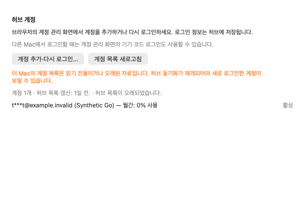
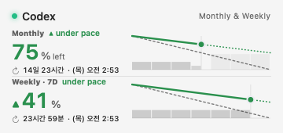

# Account sign-in and usage presentation audit

## Scope and observed installation state

This audit covers the hub-backed Codex, Claude and Grok account entry points, browser handoff, account-list refresh and freshness, and shared usage-period labels. It is not an audit of every provider's authentication implementation.

At the start of this audit, m1m1 had version 0.78.0 build 17110, commit fcb1d1abb, while the operational record reported build 17113 on m5m1. During the audit, the separate deployment recorded in 0bc0d616 installed 17113 on the clients too; a fresh local Info.plist read confirmed build 17113 and commit 149dee234. This audit's new changes are not part of that build. A source merge is not evidence that a Mac received an update.

## Confirmed problems and changes

| Problem | Resulting behavior | Implementation |
| --- | --- | --- |
| A generic management link opened the browser without explaining account addition or returning to the app. | Settings explains the handoff, provides an account-add/sign-in action and a separate account-list refresh, and displays the known accounts. Codex users see the existing server's device-code alternative for another Mac. | `OpenCodexHubAccountManagementView`, `PreferencesProvidersPane` |
| Opening the browser had no app-owned continuation or progress and could be repeated while resolving the destination. | The app tracks opening, browser handoff, checking, checked, outdated copy and failure. Busy actions are deduplicated. Opening a browser never establishes OAuth success. | `UsageStore+OpenCodexHubManagement` |
| Returning from the browser did not explicitly check the hub account list. | App activation or reopening the root menu checks once per handoff. Repeated activation does not keep polling. Manual refresh remains available. | `CodexbarApp`, `StatusItemController+Menu` |
| The normal provider refresh can fall back to native usage sources when the hub is absent. | Explicit post-sign-in account checks use the existing refresh coordinator with a hub-only scope. Missing hub data cannot turn this action into a native account or cost lookup. | `UsageStore+Refresh`, `UsageStore+OpenCodexHubManagement` |
| An asynchronous destination could outlive a source change or cancellation. | A source revision, paths and operation identity must still match before opening or publishing results. A changed-and-restored path cannot revive an old handoff. | `UsageStore+OpenCodexHubManagement` |
| A fresh local read of an old snapshot was presented as an updated account list. | Settings uses the source timestamp. Linked copies explicitly have an unknown hub-update time. Stale or read-only lists cannot be reported as a confirmed post-login update. | `OpenCodexHubPresentation.listStatus`, `OpenCodexHubSettingsDescriptors` |
| Hub quota summaries showed bare percentages despite a separate remaining/used preference. | Every summary explicitly identifies the number as used. Missing usage remains missing; zero remains a measured zero. | `OpenCodexHubPresentation.quotaSummary` |
| A nominal monthly duration appeared as a precise “30-day limit.” | Shared burn-down surfaces say “Monthly usage”; other periods describe usage, including weekly, hourly and custom durations. The compact monthly label also avoids a 30-day claim. | `BurnDownWidgetViews`, application and widget catalogs |
| A widget looking for a physical slot id ignored Codex's semantic monthly row and fell back to “Session.” | A unique matching source window supplies the published semantic title when the slot id is absent. Explicit slot titles and legacy intent identities stay intact. Repeated month labels are collapsed. | `BurnDownWidgetProvider`, `CombinedBurnDownWidgetViews` |
| Browser-open and list-refresh failures were undifferentiated. | Closed, localized messages distinguish browser failure, connection failure and a list failure after potentially successful browser sign-in. The last case requests another list read, not another OAuth attempt. | `UsageStore+OpenCodexHubManagement` |

The hub's `monthly` fields do not include a measured window duration. The existing 43,200-minute value remains a nominal lane classifier; it must not be cited as proof of an exact upstream 30-day policy. Reset timestamps continue to come from the source. This change does not alter quota enforcement or reset times.

The server behavior was read at opencodex v2.88.0, commit `6936d9885d8a9bda9301737affcbaf1a4ff00e17`: [quota mapping](https://github.com/lidge-jun/opencodex/blob/6936d9885d8a9bda9301737affcbaf1a4ff00e17/src/codex/quota.ts) and [browser/device-code choices](https://github.com/lidge-jun/opencodex/blob/6936d9885d8a9bda9301737affcbaf1a4ff00e17/gui/src/components/add-codex-account-pick-step.tsx).

## Boundaries and remaining operational work

The current status-reported, validated management URL remains the browser destination. There is no guessed data-plane fallback, new OAuth implementation, credential copy, authentication automation or expanded native key-management permission. The server owns the actual account-add and reauthentication interaction. Native non-hub login entry points remain separate.

Client snapshots are maintained by mac-infra jobs outside this application. The latest operational record says those jobs are intentionally unloaded pending actual quota recovery and their existing apply/check/idempotence procedure. A new account on the hub may therefore be absent from this Mac's list. Repeated local refreshes cannot restart that delivery mechanism. This patch identifies the stale/read-only result and does not resume those jobs or alter the proxy.

Real new-account OAuth, device-code authorization and cross-device delivery are not established by synthetic tests. Existing operational app replacement, release publication and integration remain subject to their scoped approval requirements.

## Verification

On m5m2, Build Pipeline job `C680E8C5-60D4-461D-8A95-046DC357F564` passed 113 focused tests: 77 application Swift Testing cases, 29 shared Swift Testing cases and 7 XCTest cases. These include the new browser lifecycle, cancellation and source-revision regressions; an unavailable hub cannot invoke the native provider transport. The suite also covers existing native login, hub role policy, widget projection and legacy widget compatibility.

Job `607B16C5-24C9-46CE-B5BE-666812EEA0D8` passed another 21 existing coordinator, request-context, coalescing and status-publication tests using the same binaries. Together these runs passed 134 tests.

`make check` exited 0, with 3,111 Swift files and no SwiftLint violations. Application catalogs passed against 2,729 English keys across 22 other languages; generated widget catalogs passed across 23 languages and 199 keys. No gate was disabled. The full-index source diff over `Sources`, `Tests` and `Scripts` has matching SHA-256 `46ce63ad9cbb4c9ce09a9dd9a338aa430afa78881e46f687bfa8c922ffe2a269` locally and on the build host. Later installation-record updates on `gujo` affect documentation only.

The two rendering tests ran with proof output enabled, producing six account-panel captures (English and Korean, browser handoff, checked list and stale list) and four widget captures. Representative captures follow; all identities and quota values are synthetic. These are isolated product views, not a claim of end-to-end OAuth or a complete operational Settings-window test.

